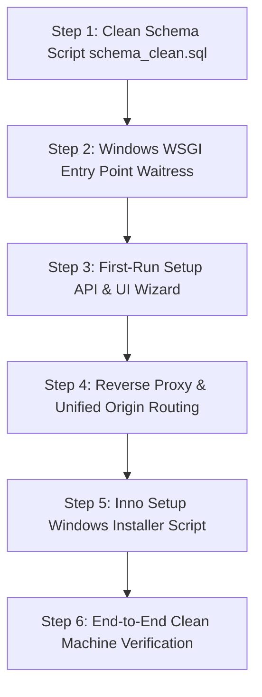

# VMS Installation Gaps and Implementation Roadmap

## 1. Overview

This document itemizes the exact technical gaps that must be resolved before the Visitor Management System (VMS) can be packaged into a turnkey commercial installer. Every item is cross-referenced with the verified codebase.

---

## 2. Gap Inventory & Impact Matrix

| Ref # | Domain | Gap Description | Severity | Target File(s) |
| :---: | :--- | :--- | :---: | :--- |
| **G-01** | Database | Fragmented schema & hardcoded test seed data | **Blocker** | `mysql_schema.sql`, `init_db.py`, `init_superadmin_db.py` |
| **G-02** | Security | Missing first-run administrator setup flow | **Blocker** | `routes/auth_routes.py`, `app.py`, `vms_frontend` |
| **G-03** | Runtime | Gunicorn incompatiblity on Windows host | **Blocker** | `vms_backend/Dockerfile`, `vms_backend/requirements.txt` |
| **G-04** | Networking | Hardcoded CORS origins restricting LAN access | **High** | `vms_backend/app.py:L18` |
| **G-05** | Hardware | Webcam capture blocked over unencrypted LAN | **High** | `SecurityPassCreate.jsx`, `VisitorPreCheckIn.jsx` |
| **G-06** | Config | Manual `.env` generation required | **Medium** | `vms_backend/.env.example`, `config/db.py` |
| **G-07** | Packaging | Lack of automated Windows service wrapper | **Medium** | New packaging build scripts |

---

## 3. Detailed Gap Analysis and Technical Remedies

### Gap G-01: Fragmented Database Schema and Test Data Contamination
- **Current State**:
  - `mysql_schema.sql` contains full DDL definitions, but also contains hardcoded mock data, test visitor check-in records, and predefined sample users.
  - Multi-site schema columns (`site_id`, `site_code`, tenant allocation) are separated in `migrate_multisite_schema.py` and `init_superadmin_db.py`.
- **The Problem**: Running the current SQL file creates demo records on customer databases, violating client data ownership and creating security hazards.
- **Required Solution**:
  1. Consolidate all database tables into a single, clean `schema_clean.sql` script that includes:
     - All multi-site tables (`sites`, `user_sites`, `visitor_sites`).
     - Proper indexes, foreign keys, and default timestamps.
     - **Zero mock users, zero dummy visitors, zero sample logs**.
  2. Embed a python migration/setup utility (`setup_database.py`) that runs automatically on initial installation to verify table presence without overwriting existing client tables.

---

### Gap G-02: Missing First-Run Provisioning & Initial Administrator Wizard
- **Current State**:
  - The application assumes an administrator account already exists.
  - If a clean database is deployed, users are directed to the `/login` screen where no accounts exist. The only existing way to create an administrator is running Python scripts via terminal (`init_superadmin_db.py` or `register_test_user.py`).
- **The Problem**: Non-technical clients cannot run terminal scripts to create their administrator account.
- **Required Solution**:
  1. **Backend Detection Route (`GET /api/setup/status`)**:
     - Inspects the `users` table. If `SELECT COUNT(*) FROM users` equals `0`, returns `{ "needs_setup": true }`.
  2. **First-Run Provisioning Route (`POST /api/setup/initialize`)**:
     - **Strict Security Gate**: Rejects requests if `users` table count > 0 (prevents replay or account hijacking).
     - Accepts: Organization Name, Default Site Name/Code, Initial Admin Name, Email, and Password.
     - Creates the primary site, hashes the password via `bcrypt`, inserts the initial `admin` / `superadmin` user, and marks setup as completed.
  3. **Frontend Setup Wizard**:
     - Frontend router checks setup status on load. If `needs_setup: true`, automatically redirects to a clean, user-friendly 3-step setup wizard before showing the login page.

---

### Gap G-03: Gunicorn Incompatibility on Windows Hosts
- **Current State**:
  - The production backend in Docker relies on Gunicorn ([vms/vms_backend/Dockerfile:L24](file:///z:/Projects/VMS/vms/vms_backend/Dockerfile#L24)).
  - Gunicorn depends on POSIX system calls (`fork`, `fcntl`) that do not exist in the Windows operating system.
- **The Problem**: Gunicorn crashes immediately if invoked directly on Windows.
- **Required Solution**:
  - Add **`waitress`** to `requirements.txt`.
  - Create a Windows production runner script `run_production_windows.py`:
    ```python
    from waitress import serve
    from app import app
    import os

    port = int(os.environ.get("PORT", 5000))
    serve(app, host="127.0.0.1", port=port, threads=8)
    ```

---

### Gap G-04: Hardcoded CORS Origins Restricting LAN Access
- **Current State**:
  - [vms/vms_backend/app.py:L18](file:///z:/Projects/VMS/vms/vms_backend/app.py#L18) defines:
    ```python
    CORS(app, origins=["http://localhost:5173", "http://192.168.1.152:5173"], supports_credentials=True)
    ```
- **The Problem**: In client production environments, the server's LAN IP will vary (e.g., `192.168.0.25`, `10.0.0.15`). The frontend will be served on port 80/443, not `5173`. Any API call from another LAN PC will be blocked by CORS policy.
- **Required Solution**:
  - **Option 1 (Recommended - Reverse Proxy / Unified Origin)**: In production, serve the frontend static build from the same web server/proxy on port 80/443 and route `/api/*` to `127.0.0.1:5000`. When frontend and backend share the same origin, **CORS is completely bypassed**.
  - **Option 2 (Environment Driven)**: Modify CORS configuration to allow local subnets or accept `ALLOWED_ORIGINS` from `.env`.

---

### Gap G-05: Webcam Photo Capture Restrictions on LAN Browsers
- **Current State**:
  - Receptionists take visitor photos using `react-webcam` ([SecurityPassCreate.jsx](file:///z:/Projects/VMS/vms/vms_frontend/src/pages/security/SecurityPassCreate.jsx)).
  - Web browsers mandate a **Secure Context** (HTTPS or `localhost`) to access camera hardware.
- **The Problem**: If a receptionist opens `http://192.168.1.100/` from their desk PC, Chrome/Edge will disable the camera with a permission error: *"getUserMedia() is only available in secure contexts"*.
- **Required Solution**:
  - Bundle a self-hosted TLS reverse proxy (Caddy with local CA or Nginx with an auto-generated internal SSL cert).
  - Provide an automatic CA certificate installer during setup, enabling receptionists to access `https://vms.local` or `https://[Server-IP]` with full camera privileges.

---

### Gap G-06: Manual `.env` Configuration Dependency
- **Current State**:
  - The backend relies on a manually created `.env` file containing database credentials and `SECRET_KEY`.
- **The Problem**: Asking clients to create a `.env` file or paste MySQL passwords violates the zero-terminal rule.
- **Required Solution**:
  - The installer script must automatically generate `.env` during installation:
    1. Generates a secure random 64-char string for `SECRET_KEY`.
    2. Generates a secure random password for the internal `vms_user` MySQL account.
    3. Writes these values to `.env` with restricted local administrator read permissions.

---

### Gap G-07: Background Process and Service Management
- **Current State**:
  - Backend runs as an interactive foreground process or Docker container.
- **The Problem**: On Windows, closing a command prompt or logging off the user terminates the backend server and halts office visitor check-ins.
- **Required Solution**:
  - Integrate **WinSW** (Windows Service Wrapper) or **NSSM** in the installer script.
  - Automatically install two resilient Windows Services:
    1. `VMS-Database` (MariaDB portable service)
    2. `VMS-Backend` (Waitress WSGI service)
  - Configure both services with `StartupType = Automatic` and automatic restart on failure.

---

## 4. Priority Implementation Sequence


