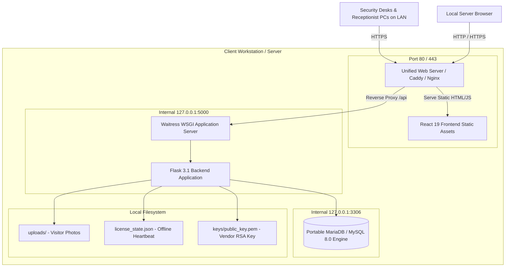
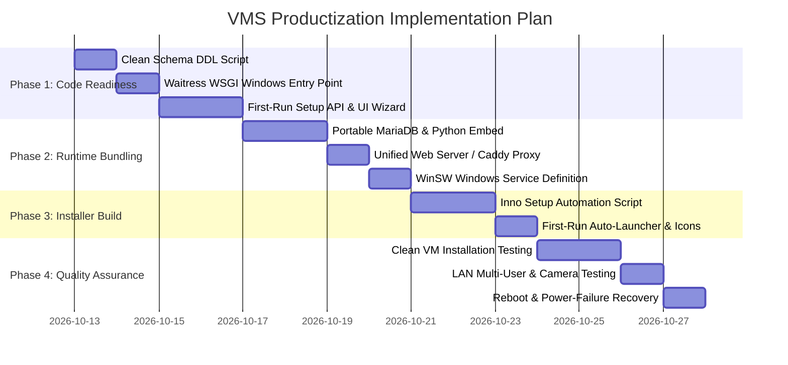

# VMS Commercial Productization — Executive Summary & Roadmap

## 1. Executive Summary

This architecture audit assessed the commercial packaging feasibility of the **Visitor Management System (VMS)**. The goal is to provide enterprise clients with a simple, self-hosted installer that enables full ownership of their data without requiring cloud hosting, Docker configuration, terminal commands, or manual database management.

### Key Audit Findings
1. **Application Maturity**: The application is functionally mature, featuring robust multi-site management, visitor badging, facial photo capture, role-based access control, analytics, and cryptographically verified offline licensing (RS256 JWT).
2. **Database Engine**: The application relies strictly on MySQL-specific SQL functions and dialect semantics (`TIMESTAMPDIFF`, `DATE_FORMAT`, `DAYNAME`, `LAST_INSERT_ID()`). MySQL/MariaDB must be retained; swapping to SQLite would require extensive query rewrites and introduces file-locking risks in multi-terminal environments.
3. **Packaging Strategy**: **Option A (Windows Native Inno Setup Installer)** is the recommended path. It delivers a 1-click GUI setup, bundles an embedded zero-configuration MariaDB engine and Python runtime, and avoids the client-side Docker Desktop licensing and virtualization requirements.

---

## 2. Recommended Product Architecture

---

## 3. Proposed Client Installation Experience

The client experiences a familiar, consumer-grade software installation flow:

### Step 1: 1-Click Installer Execution
- Client downloads `VMS_Setup_v1.0.exe` (~180 MB).
- Runs the installer (Windows standard GUI: License Agreement -> Install Location -> "Install").
- The installer silently:
  - Extracts the pre-configured portable MariaDB engine and embedded Python runtime.
  - Automatically initializes the database schema (`schema_clean.sql`) with zero dummy data.
  - Generates a cryptographically strong, unique `SECRET_KEY` and database credentials in `.env`.
  - Installs and starts two background Windows Services (`VMS-Backend` and `VMS-Database`) configured for automatic startup on system reboot.
  - Creates a desktop shortcut and automatically launches the default web browser to `http://localhost/`.

### Step 2: First-Run Setup Wizard (Browser)
- The application detects that no administrators exist and displays a clean 3-step setup wizard:
  1. **Organization Profile**: Company Name, Primary Site Name, and Site Code.
  2. **Administrator Account**: Admin Name, Email, and Master Password.
  3. **License Activation**: Paste commercial license token (or click "Start 14-Day Evaluation").
- Clicking **"Complete Setup"** hashes the password, records the organization site, permanently locks the setup wizard against replay attacks, and redirects to the login screen.

### Step 3: Immediate Operational Readiness
- The initial administrator logs in and begins:
  - Creating security guard and receptionist accounts.
  - Registering company host employees.
  - Checking in visitors and printing badges.
  - Providing the server's LAN IP address (`https://192.168.x.x/`) to other security workstations.

---

## 4. Key Strategic Decisions for Stakeholders

| Decision Item | Options | Recommendation & Rationale |
| :--- | :--- | :--- |
| **Code Signing Certificate** | 1. Unsigned binary 2. EV / Standard Code Signing Cert | **Purchase standard or EV certificate**. Unsigned installers trigger Microsoft SmartScreen warnings (*"Windows protected your PC"*), creating friction for non-technical clients. |
| **LAN Camera Security Context** | 1. Localhost only 2. Bundled Caddy with auto-generated CA cert | **Option 2 (Bundled Caddy)**. Modern browsers disable webcam access over unencrypted LAN IP (`http://192.168.x.x`). A local CA ensures receptionist webcams work smoothly across office computers. |
| **Licensing Default** | 1. Strict lock (key required) 2. 14-Day Offline Trial mode | **Option 2 (Trial Mode)**. Allowing an immediate 14-day trial improves adoption by letting clients test without waiting for vendor license token delivery. |

---

## 5. Phased Implementation Roadmap

---

## 6. Audit Documentation Index

The complete findings of this productization audit are available across the following 5 deliverables:

1. [VMS_PROJECT_OVERVIEW.md](file:///z:/Projects/VMS/docs/productization/VMS_PROJECT_OVERVIEW.md) — Comprehensive architecture, verified directory structures, runtime dependencies, and frontend/backend configurations.
2. [VMS_DEPLOYMENT_DEPENDENCIES.md](file:///z:/Projects/VMS/docs/productization/VMS_DEPLOYMENT_DEPENDENCIES.md) — Detailed specifications of system runtimes, network ports, browser security contexts, and storage requirements.
3. [VMS_PRODUCTIZATION_ASSESSMENT.md](file:///z:/Projects/VMS/docs/productization/VMS_PRODUCTIZATION_ASSESSMENT.md) — Comparative evaluation of the 4 packaging alternatives (Windows Installer, Docker, Linux, Portable App).
4. [VMS_INSTALLATION_GAPS.md](file:///z:/Projects/VMS/docs/productization/VMS_INSTALLATION_GAPS.md) — Detailed breakdown of technical gaps (schema cleanup, first-run wizard, Waitress WSGI, and CORS remedies).
5. [VMS_PRODUCTIZATION_SUMMARY.md](file:///z:/Projects/VMS/docs/productization/VMS_PRODUCTIZATION_SUMMARY.md) — (This document) Executive summary, recommended target architecture, and rollout roadmap.
